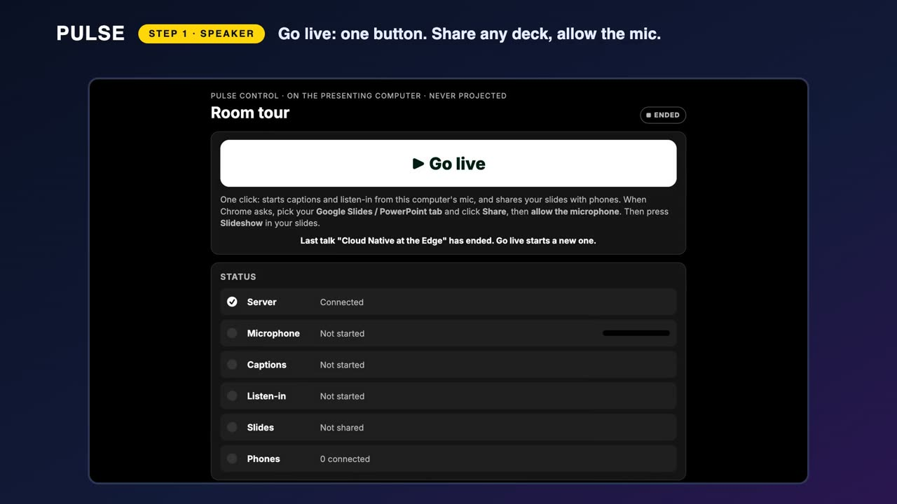
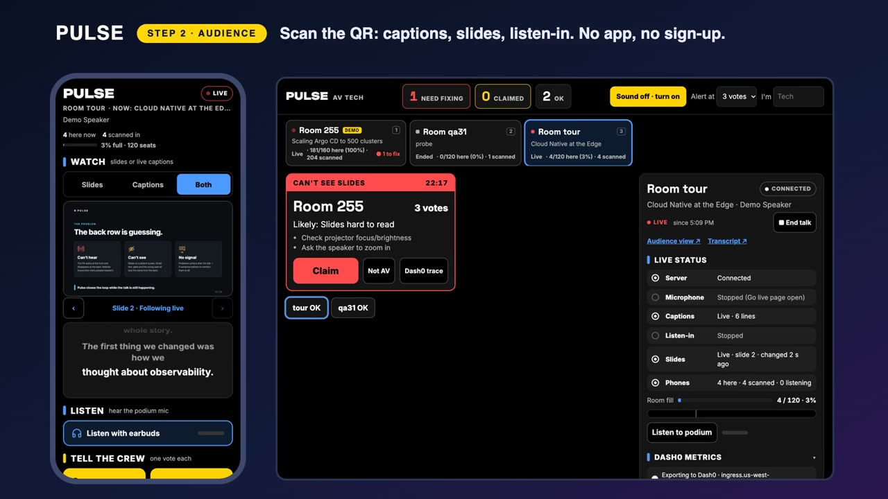
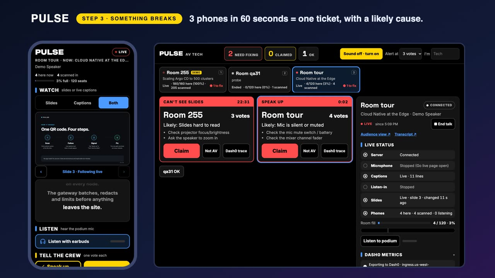
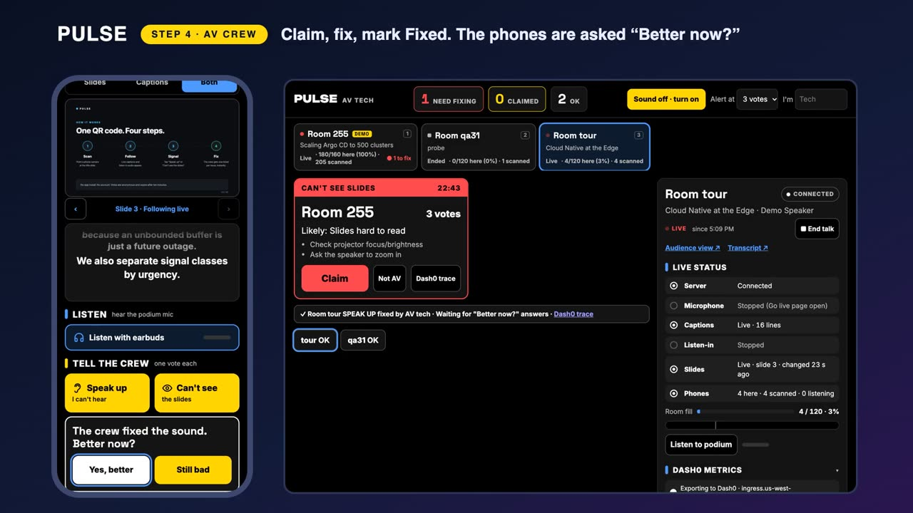
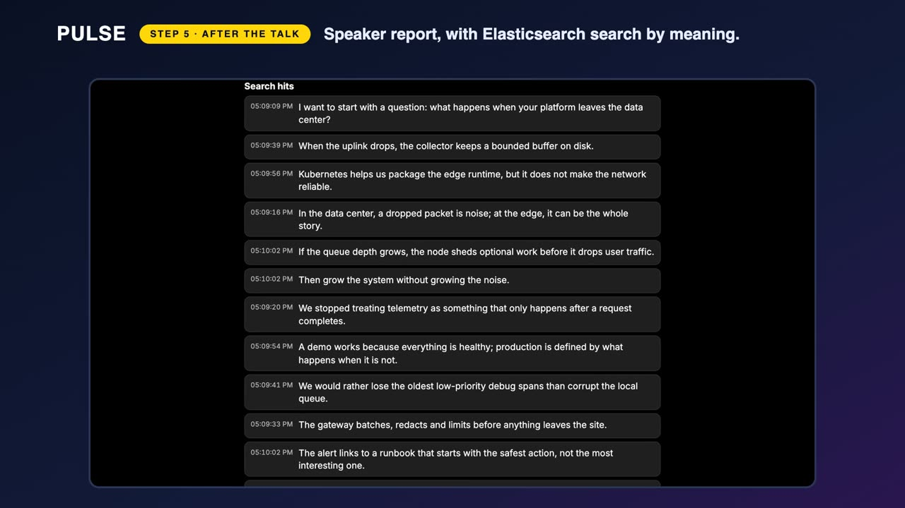
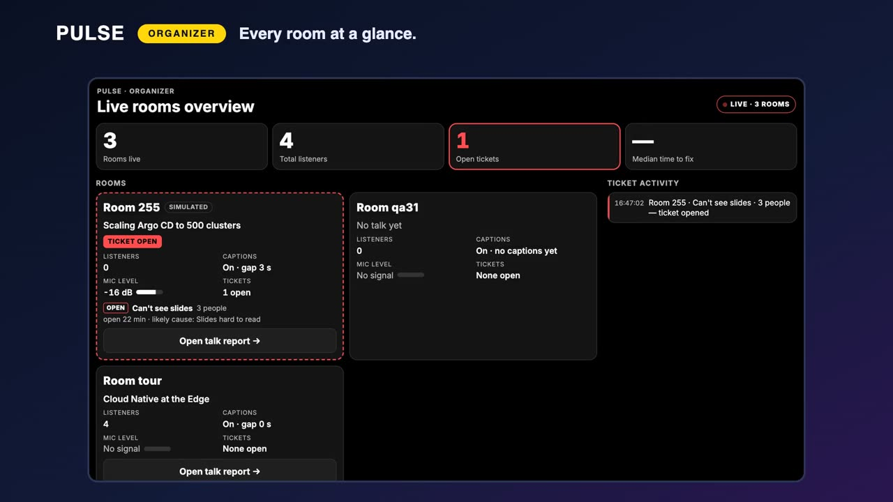

# Try Pulse yourself: a click-by-click guide for judges

Two ways to try it. Path A needs nothing but a phone. Path B runs the whole thing on your own computer, with you as the speaker.

- **Demo deck (download):** [pulse-demo-deck.pdf](pulse-demo-deck.pdf), six slides. Any deck of your own works too: Google Slides, PowerPoint, Keynote or a PDF.
- **Run of show for our live demo:** [DEMO.md](DEMO.md)

---

## Path A: two minutes, phone only (the hosted demo)

Base address: `https://tune-reveals-lakes-tuning.trycloudflare.com` (up through judging).

1. **On your phone**, open `/r/255`. This room plays a simulated talk around the clock.
2. Read the **live captions**. Press **A+** to make them larger.
3. Tap **Slides** or **Both** to see the speaker's slides. Swipe back to a slide you missed, then tap **Live**.
4. Tap **Listen with earbuds** to hear the podium mic.
5. Tap **Speak up** (I can't hear) or **Can't see**. Your tap is one vote; three different phones inside a minute open a ticket for the AV crew.
6. Type a question under **Ask**. It is anonymous.
7. **On your computer**, open `/org` (every room at a glance) and `/find` (search the schedule and what speakers actually said). Try: `what happens when the network goes down`.
8. **On your phone**, open `/b/gitar` (the booth passport: one scan, one stamp, and a suggested next booth).

The speaker page and the AV console need a key, so you see those in Path B.

---

## Path B: run it yourself, with your own slides (about five minutes)

You need: a laptop with Chrome or Edge and [Node.js 22](https://nodejs.org) (newer works; ignore the engine warning), and a phone.

### Step 1. Start Pulse

**Any computer (Windows, macOS, Linux): one command.** Tested on a fresh clone.

```
git clone https://github.com/owenbodily-osbmach1/HACKATHONproject-T-O.git
cd HACKATHONproject-T-O
npm ci
npm run demo
```

No keys, accounts or files to edit. The window prints every link and opens two browser tabs: **Go live** (the speaker) and the **AV tech console**.

```
Pulse is running. Leave this window open; press Ctrl+C to stop.
  1. Go live (speaker)       http://localhost:8080/go/151?key=...
  2. AV tech console         http://localhost:8080/tech?key=...
  3. Audience phone page     http://<your-laptop-ip>:8080/r/151
```

- Phones on the **same Wi-Fi** scan the QR code on Go live. For phones on mobile data: `npm run demo -- --phones` (needs [cloudflared](https://developers.cloudflare.com/cloudflare-one/connections/connect-networks/downloads/)).
- One phone is enough to open a ticket here (the alert limit is set to 1). The real rule is 3 different phones inside 60 seconds.
- More options and fixes: [QUICKSTART.md](QUICKSTART.md).

**Windows, no terminal:** download the repository (green **Code** button, then **Download ZIP**), unzip it, open the `tools` folder and double-click **`start-pulse.bat`**. The first time it asks to install a small tunnel tool (cloudflared) so phones anywhere can reach your laptop: answer **Y**. It prints the same links with a public address and opens the same two tabs.

### Step 2. Go live (the speaker's laptop)



1. Open the demo deck ([pulse-demo-deck.pdf](pulse-demo-deck.pdf)) or your own slides in another Chrome tab or window.
2. On the **Go live** tab, press **▶ Go live**. That one button starts everything.
3. Chrome asks **what to share**: pick the tab or window with your slides, then click **Share**.
4. Chrome asks for the **microphone**: click **Allow**.
5. Go to your slides and press **Slideshow** (full screen). A slide is sent to phones each time it changes.
6. Look at the **Status** list on the Go live tab. Server, Microphone, Captions, Listen-in and Slides each turn green.
7. The **Join link** card on the same page shows the QR code for the room. Put it on your first slide, or just hold the laptop up.

No deck at all? Open `/present/151?key=<speaker key>`: it is a built-in presenter with the six demo slides (arrow keys to move).

### Step 3. Join as the audience (your phone)



1. Scan the QR code, or open the **Phone page** link. There is no app and nothing to install. (`start-pulse.bat` shows a short sign-in form first, the event's optional attendee list: type anything. It stays in the server's memory only and is gone on restart.)
2. Talk. Your words appear as **captions** on the phone within a second or two.
3. Tap **Both** to see captions and slides together. Change the slide on the laptop and watch the phone follow.
4. Tap **Listen with earbuds** to hear the laptop's microphone on the phone.

### Step 4. Break something (phone, then the AV console)



1. On the phone, tap **Speak up** (I can't hear).
2. Look at the **Tech screen** tab. A red ticket appears with the room, the vote count, a likely cause and the steps to fix it.
3. Press **Claim**, then **Mark fixed**.



4. The phone asks **Better now?** Tap **Yes, better** to close the loop, or **Still bad**: enough of those reopen the ticket.
5. Each ticket has a **Dash0 trace** button. With a Dash0 account connected, it opens that ticket's open, claim and fix steps as trace spans.

### Step 5. After the talk (the speaker report)



1. Press **■ End talk** on the Go live tab (it saves the transcript). On the Tech screen, click **Transcript ↗** in the room panel to open the report (`/t/<talk id>`).
2. You get the full transcript, a timeline of when people struggled, and their questions.
3. Type a question into **Search**. With Elasticsearch connected it searches by meaning, not only by keyword. (Without an Elasticsearch key in `.env`, the transcript is still there; search needs the key.)

### Step 6. The rest of the venue

| Page | What it is |
| --- | --- |
| `/org` | Organizer view: every room, who is live, which rooms need help |
| `/find` | Find the right talk: search the schedule and what was said |
| `/b/gitar` | Booth page on a phone: passport stamp and next-booth suggestion |
| `/cards` | Printable QR cards for rooms and booths |



---

## If something does not work

- **Captions stay empty:** use Chrome, and check that the microphone was allowed (the Microphone row on Go live shows a moving level).
- **Slides do not reach the phone:** the shared tab or window must be the one with the slides, and the deck must be in Slideshow (full screen).
- **Phone cannot open the page:** phone and laptop must be on the same Wi-Fi. `npm run demo -- --phones` or `start-pulse.bat` avoids this with a public link.
- **Port 8080 is busy:** Pulse moves to the next port and prints the new links.
